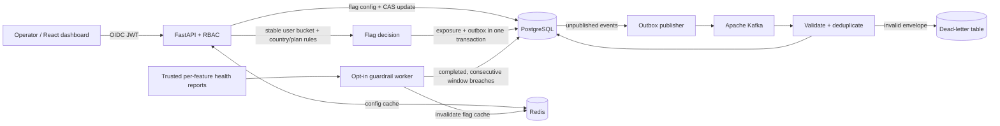

# LaunchPilot
### Feature Delivery & Release Operations Platform

**Ship gradually. Measure outcomes. Detect unhealthy rollouts. Roll back safely.**

LaunchPilot is a working **React + FastAPI** release-control application demonstrating progressive feature delivery and operational reliability. Operators create feature flags, target audiences, evaluate deterministic rollouts, examine exposure/conversion activity, inspect a transactional event pipeline, and use manual or *opt-in* SLO-triggered rollback.

The application runs in two modes: a quick **SQLite + demo-auth** development mode and a **Docker Compose integration environment** using real Keycloak, PostgreSQL, Redis, and Kafka. It is a **reference implementation**, not an internet-hardened, publicly deployed SaaS.

[Architecture deep dive](docs/architecture.md) · [Product demonstration guide](docs/demo.md) · [Record the browser walkthrough](.github/workflows/product-demo.yml) · [GitHub Actions](https://github.com/kartikeya27/launchpilot-feature-delivery-platform/actions)

[](https://github.com/kartikeya27/launchpilot-feature-delivery-platform/actions/workflows/ci.yml)
[](https://github.com/kartikeya27/launchpilot-feature-delivery-platform/actions/workflows/fullstack.yml)
[](https://github.com/kartikeya27/launchpilot-feature-delivery-platform/actions/workflows/security.yml)

## At a glance

| Engineering problem | Implemented response |
| --- | --- |
| All-at-once rollouts | Flag control, deterministic SHA-256 buckets, version-checked configuration changes |
| Different audiences | Country/plan allowlists and match-all/match-any targeting |
| Loss of events between database and broker | PostgreSQL transactional outbox, Kafka publisher, idempotent receipt consumer |
| Poison events | Durable quarantine for malformed records and administrator-reviewed replay |
| Unhealthy releases | Administrator kill switch and **opt-in** guardrail worker for sustained error/latency breaches |
| Unauthorized release changes | Keycloak OIDC + PKCE, JWT validation, server-enforced admin/viewer RBAC |
| Limited operational insight | Audits, queue counters, seven-day activity, OpenTelemetry, Prometheus/Grafana/Jaeger |
| Regressions | Pytest, PostgreSQL integration, full-stack Playwright, a11y, bounded load smoke, security scans |

## The release story



**Walkthrough:** An administrator creates a staging checkout flag, sets its rollout, and enables it. A synthetic user receives the same hash bucket for repeated evaluations. A tracked evaluation persists an exposure **and** an outbox record together; a separate worker publishes to Kafka and the consumer records a deduplicated receipt. Operations displays **database-derived counters**; these do not measure broker health. A trusted service can submit error/latency observations to the *disabled-by-default* SLO guardrail. After adequate samples in consecutive completed windows, the worker can disable the flag and audit the action. The demo also shows the immediate **manual** rollback button.

**Important distinction:** Analytics are descriptive, not proof of causal experimentation. The Kafka stream is at-least-once, not exactly-once. SLO guardrails require trusted external measurements; they do not automatically observe downstream applications.

See [Architecture](docs/architecture.md) for the complete event sequence, failure modes, and security boundaries.

## Try it locally

### Option A — Fast demo (no Docker)

Requirements: Python 3.11/3.12, Node.js 22+, npm.

```bash
git clone https://github.com/kartikeya27/launchpilot-feature-delivery-platform.git
cd launchpilot-feature-delivery-platform
./scripts/start.sh
```

- UI: http://127.0.0.1:5173
- OpenAPI: http://127.0.0.1:8000/docs

This option uses **SQLite and localhost-only demo authentication**. It does **not** run Kafka, Redis, Keycloak, or PostgreSQL.

### Option B — Real local integration stack

Requirements: Docker Desktop (Mac Apple Silicon supported; provide adequate memory, ideally at least 8 GB).

```bash
docker compose -f compose.production.yaml config --quiet
docker compose -f compose.production.yaml up --build -d
docker compose -f compose.production.yaml ps
```

Open http://localhost:8000 (use **localhost**, not 127.0.0.1, for the local Keycloak redirect). The repository seeds synthetic, disposable local accounts:

| Role | User | Local-only password |
| --- | --- | --- |
| Admin | `demo-admin` | `AdminDemo123!` |
| Viewer | `demo-viewer` | `ViewerDemo123!` |

Never reuse these credentials for a public or shared environment. Other local services: [Keycloak](http://localhost:8081), [Jaeger](http://localhost:16686), [Prometheus](http://localhost:9090), and [Grafana](http://localhost:3000).

```bash
curl -fsS http://localhost:8000/api/health/ready
docker compose -f compose.production.yaml logs --tail=50 api publisher consumer guardrail
# Stop without deleting named volumes:
docker compose -f compose.production.yaml down
```

**Never run `down -v` against a stack containing data you want to keep.** The full-stack CI workflow uses disposable test volumes and cleans those up automatically.

## Watch the product demonstration

A dedicated Playwright scenario captures a **real browser video**, screenshots, and trace evidence using synthetic staging data and the local Keycloak-backed environment. It covers login → flag creation → progressive rollout → user evaluation → event counters → manual rollback → audit.

**[Open the product demonstration workflow](https://github.com/kartikeya27/launchpilot-feature-delivery-platform/actions/workflows/product-demo.yml)** → open a successful run → **Artifacts** → download `launchpilot-demo-video` (WebM recording). The workflow also uploads `product-demo-evidence` with an HTML report and trace. Artifacts are retained for seven days, so download the video if you want a permanent copy. A later public video URL can be added here after the recording is reviewed and published.

The video demonstrates **manual rollback**, not an automatically triggered guardrail. Its infrastructure explanation comes from tested components and [docs/architecture.md](docs/architecture.md); the short recording does not itself prove a live SLO breach or disaster-recovery event.

Use [docs/demo.md](docs/demo.md) for narration, recorded scenes, and an optional guided walkthrough.

## Quality gates

| Workflow | What it verifies |
| --- | --- |
| [CI](.github/workflows/ci.yml) | Ruff, backend tests, PostgreSQL migration/integration, React typecheck/build, browser/a11y suite |
| [Full-stack release operations](.github/workflows/fullstack.yml) | Real Keycloak OIDC, rollout/evaluation, manual rollback, Kafka outage recovery and DLQ quarantine |
| [Bounded load smoke](.github/workflows/load.yml) | Small localhost concurrent evaluation benchmark with explicit error/latency limits |
| [Security scans](.github/workflows/security.yml) | CodeQL, Bandit, dependency checks, and Trivy with separate full and fixable-vulnerability reports |
| [Terraform blueprint validation](.github/workflows/terraform-validate.yml) | Static Terraform init/validation; **does not provision cloud resources** |
| [Product demo](.github/workflows/product-demo.yml) | Recorded, repeatable **real-browser** checkout-flag walkthrough |

Run real local browser tests against a running Docker stack:

```bash
cd frontend
npm install
npx playwright install chromium
npx playwright test --config=playwright.fullstack.config.ts
```

For the standalone demo recording, see [docs/demo.md](docs/demo.md).

## Stack

**Frontend:** React 19, TypeScript, Vite, Playwright, axe-core.  
**API:** Python, FastAPI, Pydantic, SQLAlchemy, Alembic.  
**Identity/data/events:** Keycloak OIDC, PostgreSQL 16, Redis 7, Kafka.  
**Telemetry:** OpenTelemetry, Jaeger, Prometheus, Grafana.  
**Delivery:** Docker Compose, GitHub Actions, Terraform GCP reference.

## Scope and deployment status

- **Verified:** automated API, UI, accessibility, Postgres integration, real local OIDC/Kafka workflow, Kafka recovery/DLQ tests, bounded load smoke, and static Terraform validation.
- **Configurable but limited:** the SLO guardrail uses authenticated, explicitly submitted measurements; Kafka/worker health is not continuously probed by Operations; DLQ replay requires admin review.
- **Not verified:** a public Google Cloud deployment, production traffic, scalability under significant distributed load, real-world disaster recovery, internet-hardening, and cloud billing/IAM/network controls.

Before any public deployment, replace local credentials, review vulnerabilities and IAM/secrets/network policy, deploy to an authorized cloud project, and complete live OIDC, database, Kafka, and recovery smoke tests. [Cloud verification helper](scripts/cloud_smoke.sh) is read-only; the Terraform workflow does not run `apply`.

## Repository map

```text
backend/app/           API, bucketing, guardrails, DLQ, Redis/Kafka workers
backend/tests/         API/guardrail/targeting tests
backend/integration/   Real PostgreSQL integration tests
frontend/src/          React dashboard and Operations Center
frontend/e2e/          Lightweight Playwright / accessibility tests
frontend/fullstack/    Keycloak-backed browser workflow
frontend/demo/         Recorded product walkthrough
infra/                  Keycloak, telemetry, Terraform blueprint
scripts/               Local startup, recovery exercises, bounded load checks
docs/                  Architecture explanation and demo narration guide
.github/workflows/     CI, full-stack, security, Terraform, load, recorded demo
```

**License and contribution:** Please review repository licensing and security obligations before reuse. The seeded identities and sample infrastructure exist only for educational local demonstrations.
