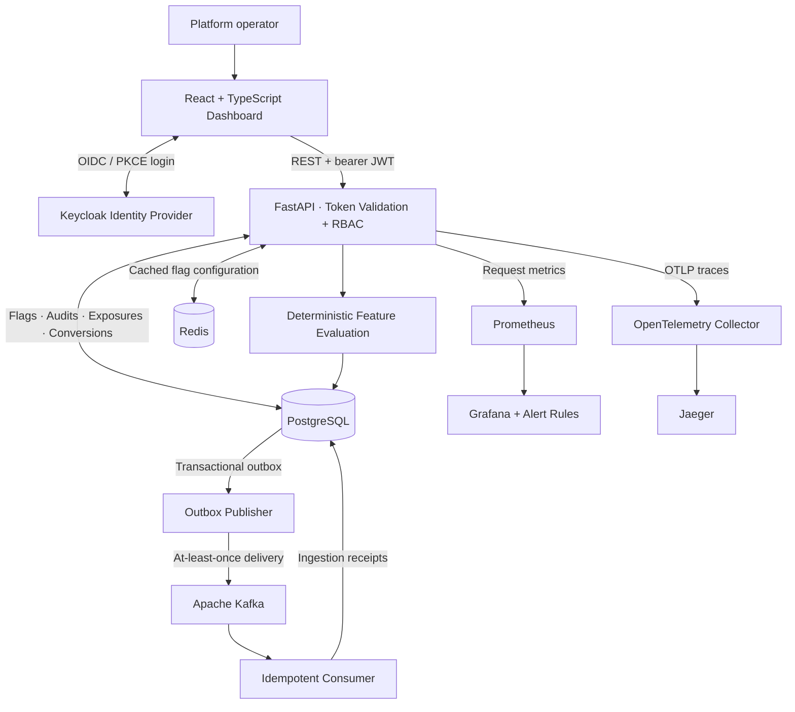

# LaunchPilot — Feature Delivery Platform

### Full-Stack Feature Flags, Progressive Rollouts & Experiment Analytics

LaunchPilot is a full-stack application for **releasing software features safely, measuring their impact, and understanding what happens after a rollout**. It combines a React dashboard, a Python API, deterministic feature evaluation, access controls, event ingestion, experiment analysis, and observability in a cohesive platform for exploring modern progressive-delivery architecture.

Instead of deploying a change to every user at once, a team can turn a feature on for a small percentage of users, monitor results, and gradually expand its rollout—without redeploying the application.

> **Deployment status:** This repository runs locally, with either a lightweight mode or a multi-service Docker stack. It is not an internet-hardened production deployment. Cloud infrastructure is provided as an untested deployment blueprint.

## The Problem LaunchPilot Solves

Releasing new functionality to every user at once creates risk: a bug can affect the whole audience, there may be no reliable way to compare outcomes, and changes to release settings can be difficult to trace.

| Engineering challenge | How LaunchPilot helps |
| --- | --- |
| Risky all-at-once releases | Enable flags and progressively increase rollout percentages. |
| Users switching unexpectedly between variants | Assign users to stable rollout buckets using deterministic SHA-256 hashing. |
| Unauthorized changes to release settings | Use OIDC login and server-enforced admin/viewer role-based access control (RBAC). |
| Conflicting flag updates | Use version checks and an atomic compare-and-swap update. |
| Repeated database reads | Cache flag **configuration** in Redis with TTL, invalidation, and database fallback. |
| Events lost between database writes and messaging | Record exposure/conversion events in a transactional outbox, then publish them to Kafka. |
| Limited release visibility | Track exposures, conversions, audit history, latency, errors, and distributed traces. |
| Unclear experiment outcomes | Compare observed control/treatment conversion rates, confidence intervals, and statistical-test results. |

### Example: rolling out a new checkout

1. An admin creates a `new_checkout` flag with a **10% rollout** in the production environment.
2. The API evaluates the flag for a user. The same user receives the same bucket for the same flag configuration, enabling a consistent experience.
3. The team records exposures and conversions, then reviews observed outcomes in the dashboard.
4. If the results are acceptable, the admin raises the rollout to **50%** and later **100%**, or disables the flag if problems appear.
5. The audit trail records who changed the flag and what changed; metrics and traces help investigate API behavior.

**Analytics note:** The included statistical analysis describes observed rollout cohorts. It is **not** a full randomized experimentation service and should not be interpreted as proof of causal impact.

## Core Capabilities

- **Feature management:** create, list, enable/disable, and update environment-specific feature flags.
- **Deterministic evaluation:** stable percentage rollouts using a user-and-flag hash; optional exposure tracking.
- **Security:** OpenID Connect (OIDC) sign-in using Authorization Code + PKCE; JWT validation and admin/viewer RBAC on the API.
- **Persistence:** PostgreSQL with SQLAlchemy models, Alembic schema migrations, and integration-test coverage.
- **Performance:** Redis flag-configuration cache with expiry, invalidation, and fallback on cache failure.
- **Event pipeline:** PostgreSQL transactional outbox, Kafka publisher, and idempotent event-receipt consumer.
- **Analytics:** exposure/conversion summaries, cohort comparison, two-proportion z-test, and Wilson 95% confidence intervals.
- **Observability:** OpenTelemetry traces, Jaeger, Prometheus metrics, Grafana dashboards, and example SLI/SLO alerting rules.
- **Quality:** Pytest tests, Playwright browser checks, axe-core accessibility assertions, and configured security scans.
- **Cloud architecture:** a Google Cloud Run / Cloud SQL / Redis / Terraform blueprint, **not an already deployed service**.

## Technology Stack

| Layer | Technologies |
| --- | --- |
| Frontend | React 19, TypeScript, Vite, CSS, Lucide icons |
| Backend & REST API | Python, FastAPI, Pydantic, SQLAlchemy |
| Authentication & authorization | OIDC, Keycloak (local), JWT validation, PKCE, RBAC |
| Database & schema | PostgreSQL 16, Alembic; SQLite in lightweight demo mode |
| Caching | Redis 7 |
| Events & messaging | Apache Kafka, transactional outbox, idempotent consumer |
| Tracing & monitoring | OpenTelemetry, Jaeger, Prometheus, Grafana |
| Testing & security | Pytest, Playwright, axe-core, Ruff, Bandit, pip-audit, npm audit, CodeQL, Trivy |
| Runtime & infrastructure | Docker, Docker Compose, GitHub Actions, Terraform, Google Cloud Run blueprint |

## High-Level Architecture



**How the components work together:** The UI lets authorized users manage flags. FastAPI validates permissions, persists configuration, and assigns rollout decisions. Redis reduces reads of flag configuration; PostgreSQL stores changes and analytics data. An outbox publisher sends eligible events to Kafka, where a consumer records deduplicated receipts. Prometheus/Grafana and OpenTelemetry/Jaeger provide operational visibility.

The current dashboard analytics are calculated from **PostgreSQL exposure/conversion records**, not from Kafka consumer receipts. Kafka ingestion is asynchronous and at least once, not exactly once. Redis caches configuration rather than raw user identities or individual evaluation decisions.

## Run Locally

### Prerequisites

- macOS (including Apple Silicon/M1), Linux, or a compatible development environment
- **Python 3.11+** (3.11 or 3.12 recommended)
- **Node.js 22.12+** and npm
- **Docker Desktop** for the complete multi-service mode (allow approximately **8 GB or more** of available memory)

Choose one of the following approaches. **Option A** is the fastest way to explore the application; **Option B** runs the expanded architecture with real local infrastructure and authentication.

### Option A — Lightweight Local Mode (Python + React, no Docker)

This mode uses SQLite and a **localhost-only demo administrator identity**. It does **not** activate Keycloak, Kafka, PostgreSQL, or Redis. Do not expose it to the internet.

**1. Extract the downloaded project:**

```bash
cd ~/Downloads
unzip launchpilot-feature-delivery-platform.zip
cd launchpilot-feature-delivery-platform
```

If you are working from an existing GitHub clone, just open the project directory instead of unzipping it.

**2. Start the API and frontend:**

```bash
chmod +x scripts/start.sh
./scripts/start.sh
```

The script creates a Python virtual environment, installs backend and frontend dependencies, and starts both development servers. Initial installation requires internet access.

**3. Open the local URLs:**

| Service | Address |
| --- | --- |
| React dashboard | http://127.0.0.1:5173 |
| FastAPI interactive documentation | http://127.0.0.1:8000/docs |
| API health | http://127.0.0.1:8000/api/health |

To stop this mode, press **Ctrl+C** in the Terminal running the startup script.

### Option B — Full Local Architecture (Docker Desktop)

This mode starts **PostgreSQL, Redis, Kafka, Keycloak, an Alembic migration job, FastAPI + built React UI, publisher/consumer workers, OpenTelemetry Collector, Jaeger, Prometheus, and Grafana**.

**1. Start Docker Desktop** and open the project root in Terminal.

**2. Check the configuration and start containers:**

```bash
docker compose -f compose.production.yaml config --quiet
docker compose -f compose.production.yaml up --build -d
docker compose -f compose.production.yaml ps
```

The first build may need to download large container images. The `migrate` job should finish successfully; the long-running application services should remain running.

**3. Open LaunchPilot and sign in:**

Use **http://localhost:8000** for the dashboard. Use `localhost` rather than `127.0.0.1` in this mode because the default Keycloak issuer is configured for `localhost`.

| Local demo role | Username | Password |
| --- | --- | --- |
| Administrator (manage flags) | `demo-admin` | `AdminDemo123!` |
| Viewer (read/evaluate) | `demo-viewer` | `ViewerDemo123!` |

These are **throwaway development-only accounts** imported from `infra/keycloak/launchpilot-realm.json`. Never reuse these credentials or the included development settings in a public deployment.

**4. Explore the local services:**

| Service | Address |
| --- | --- |
| Dashboard | http://localhost:8000 |
| API documentation | http://localhost:8000/docs |
| Keycloak | http://localhost:8081 |
| Jaeger traces | http://localhost:16686 |
| Prometheus | http://localhost:9090 |
| Grafana | http://localhost:3000 |

Grafana development login: `admin` / `local-only-grafana-pass`.

**5. Check health and troubleshoot startup:**

```bash
curl http://localhost:8000/api/health
curl http://localhost:8000/api/health/ready
docker compose -f compose.production.yaml logs --tail=80 api migrate keycloak kafka publisher consumer
```

Both health endpoints should return a success status once the service and database are ready. Initial service startup may take some time.

**6. Stop the stack when finished:**

```bash
docker compose -f compose.production.yaml down
```

Named volumes are kept, so local database data survives normal shutdown. Running `down -v` would **delete the local test data**.

### Try the Main Workflow

Once the dashboard is open:

1. Visit **Feature Flags** and review or edit a flag (admin required for changes).
2. Visit **Evaluation Lab**, select a flag, and evaluate a synthetic user ID.
3. Visit **Overview** and generate demo traffic (admin only).
4. Visit **Experiments** to compare observed exposure and conversion cohorts.
5. Visit **Audit Trail** to inspect configuration changes.
6. In Docker mode, open **Jaeger** and **Grafana** to inspect traces and service metrics.

For a basic local backend test run, after dependencies have been installed:

```bash
cd backend
.venv/bin/python -m pytest -q tests
```

The repository also contains PostgreSQL integration tests, Playwright browser/accessibility tests, security workflows, and a Terraform deployment blueprint. **Those configurations are included, but full end-to-end and public-cloud deployment validation must be performed in the target environment.**

## Inspect Browser Automation Evidence

The **CI** workflow runs Playwright against a temporary local FastAPI + React instance in headless Chromium, using synthetic demo data. Each CI run saves an HTML test report, screenshots, browser videos, and action/network traces—including when tests pass.

1. Open the repository's **Actions** tab, select the latest **CI** run on **main**, and open the **e2e** job to see the browser-test summary.
2. At the bottom of that workflow run, download the **playwright-browser-evidence** artifact.
3. Unzip the artifact and open **playwright-report/index.html** in a browser for per-test results, screenshots, videos, and trace attachments.
4. To inspect a trace independently, use Playwright Trace Viewer: run `cd frontend && npx playwright show-trace path/to/trace.zip`, or open https://trace.playwright.dev and load the trace manually.

Artifacts are retained for **7 days** and are accessible to readers of this public repository. The CI run uses **demo authentication and synthetic identifiers**, not live accounts or production data. The separate OIDC browser check is skipped in demo-auth mode; passing the default suite does **not** verify a real Keycloak sign-in flow.

For a visible Chromium window on your own machine (after installing backend and frontend dependencies):

```bash
cd frontend
npx playwright install chromium
npx playwright test --headed --workers=1
# Or use the interactive test explorer:
npx playwright test --ui
```
