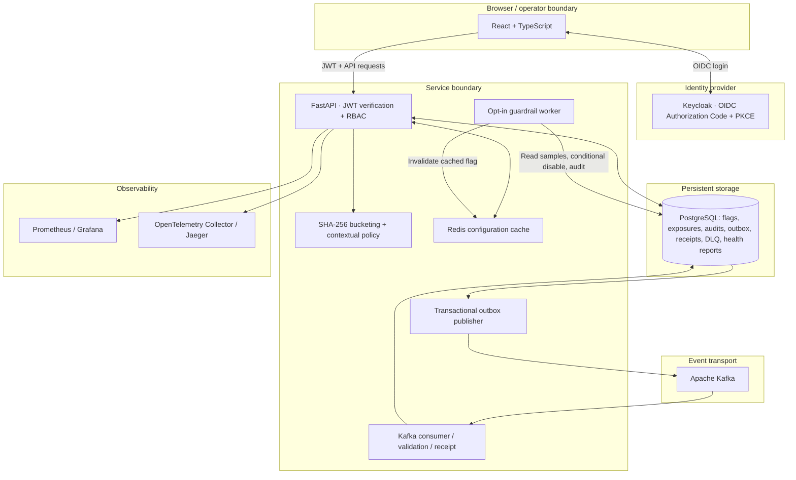
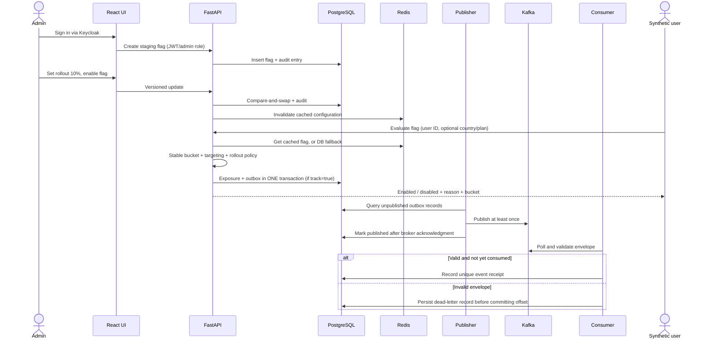
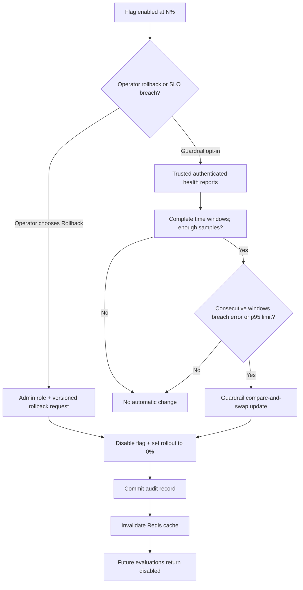

# LaunchPilot architecture: from release decision to recovery

LaunchPilot is an educational **progressive-delivery control plane**, not a CDN, client SDK, or remotely deployed enterprise service. The verified runtime is the local multi-service Docker Compose environment. The GCP Terraform files are **configuration validated only**.

## 1. Components and trust boundaries

**Security boundaries.** Keycloak issues identity tokens; FastAPI verifies JWTs and enforces admin/viewer role permissions server-side. The UI hiding a control is not an authorization check. Postgres is the source of truth for flags, audit history, exposure and conversion data. Redis caches **flag configurations**; it does not cache user identity or the individual user evaluation result. Demo OIDC users and local credentials are **not production credentials**.

## 2. Release lifecycle

**Deterministic bucketing.** The bucket derives from the flag salt, environment, flag key and user ID. With unchanged flag and user identity, the bucket is stable. The response changes if rollout percent, enablement or relevant targeting rules change. Country/plan are optional request context, and when allowlist rules exist missing context cannot bypass them.

**Consistency semantics.** A tracked evaluation writes an exposure and outbox event together, preventing the split-write failure in which the database updates but the message is lost. The publisher can retry after crashes or Kafka outages. Because re-delivery is possible, the consumer enforces uniqueness on event receipts. It is **at-least-once delivery plus idempotent ingestion**, not global exactly-once delivery.

**No PII promise.** User IDs are converted to salted hashes in exposure/event records, but this is *pseudonymization*, not a guarantee of anonymity. Keep test user identities synthetic.

## 3. Manual and automatic recovery

**Manual rollback:** From Operations, an administrator can disable a flag and reset rollout to 0% immediately. The API rejects stale versions and records the actor/reason. No code or container is redeployed.

**SLO rollback:** The guardrail worker is **opt-in**. It reads per-feature error/latency samples submitted through an admin-authenticated endpoint. It only evaluates **complete** windows and requires configured minimum sample counts and multiple consecutive breaches. It uses a version-checked database update, then invalidates the Redis cache and audits the event. Empty/incomplete windows do **not** trigger rollback. It does **not** automatically read external customer applications or Prometheus metrics.

**Kafka dead letters:** The consumer validates a tightly restricted event envelope. Malformed records are stored in a durable dead-letter table before Kafka offsets advance. An administrator can inspect and request replay using a corrected event; replay creates a **new** outbox record, with audit tracking. Recovery must be reviewed; replay is not an autonomous repair action.

## 4. What the dashboards mean

| Visible value | Computed from | Does **not** prove |
| --- | --- | --- |
| Evaluations/conversions | PostgreSQL exposure/conversion records | Causal experiment impact |
| Pending/published outbox | PostgreSQL outbox rows | Kafka broker uptime |
| Ingested receipts | PostgreSQL receipt rows | End-to-end exactly-once semantics |
| Dead-letter count | PostgreSQL unresolved DLQ rows | Automatic successful remediation |
| Oldest pending age | Earliest not-yet-published outbox row | Consumer lag in every Kafka partition |
| Rollback audit | Persisted operator/guardrail changes | A production SLO integration |

Prometheus and OpenTelemetry provide independent service telemetry. The Operations dashboard currently reflects DB counters, not a live broker connectivity check.

## 5. Test evidence

- **CI:** Python/Ruff, PostgreSQL migrations/integration, TypeScript build, lightweight Chromium browser/a11y.
- **Full stack:** Docker Compose PostgreSQL/Redis/Kafka/Keycloak; admin and viewer login; rollout/evaluation, manual rollback and audit; Kafka outage recovery; malformed-message quarantine.
- **Load:** bounded, local-only evaluations with latency/error thresholds, not a production-scale claim.
- **Security:** static analysis, dependency scans and container CVE reporting; remaining *unfixed* advisories can still appear in the full Trivy report.
- **Cloud:** Terraform init/validate with no billing, credentials, or apply. A real HTTPS public-cloud deployment is **not verified**.

The [recorded browser walkthrough](demo.md) is a short **UI demonstration** of the release workflow. It is not a video of an SLO breach or infrastructure recovery; those remain independently testable behaviors.

## 6. Failure scenarios and system responses

| Failure | Design response / limitation |
| --- | --- |
| API and database healthy; Kafka unavailable | Exposure + outbox transaction survives. Worker retries publication when Kafka returns. |
| Producer crashes after broker ACK but before DB mark | Duplicate publish possible; consumer receipt uniqueness prevents duplicate ingestion. |
| Corrupted Kafka payload | Durable DLQ record; administrator must inspect and replay corrected values. |
| Two admins change the same rollout | Compare-and-swap on flag version rejects stale modification (HTTP 409). |
| Redis unavailable | Bounded config cache, database fallback; Redis is not authoritative. |
| Insufficient or sporadic health samples | Guardrail does **not** auto-rollback. |
| True production outage | Not established: local tests and Terraform validation are not cloud operational proof. |

## 7. Technical architecture overview

> LaunchPilot models progressive feature delivery across a React/TypeScript control plane and a FastAPI service. An administrator authenticates with Keycloak and configures versioned feature flags. Each evaluation applies contextual targeting and deterministic SHA-256 bucketing; tracked decisions persist an exposure and outbox event transactionally in PostgreSQL. A worker publishes to Kafka, and an idempotent consumer writes receipts or quarantines malformed messages. Redis caches configuration with invalidation, while OpenTelemetry and Prometheus provide service observability. The Operations Center supports audited manual rollback, plus an optional guardrail that disables a flag after consecutive completed error/latency windows. The architecture is validated through real local Compose and Playwright tests; it isn't presented as a public production deployment.
